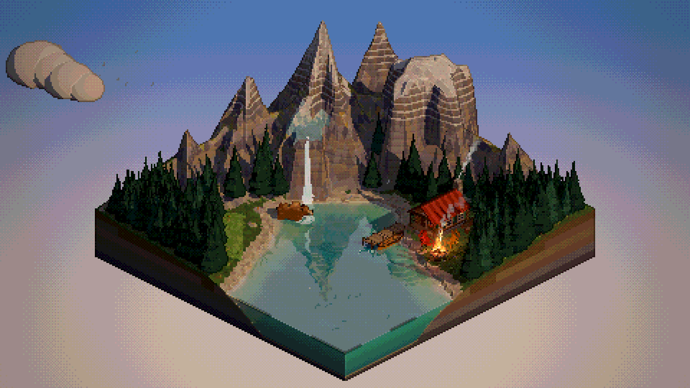
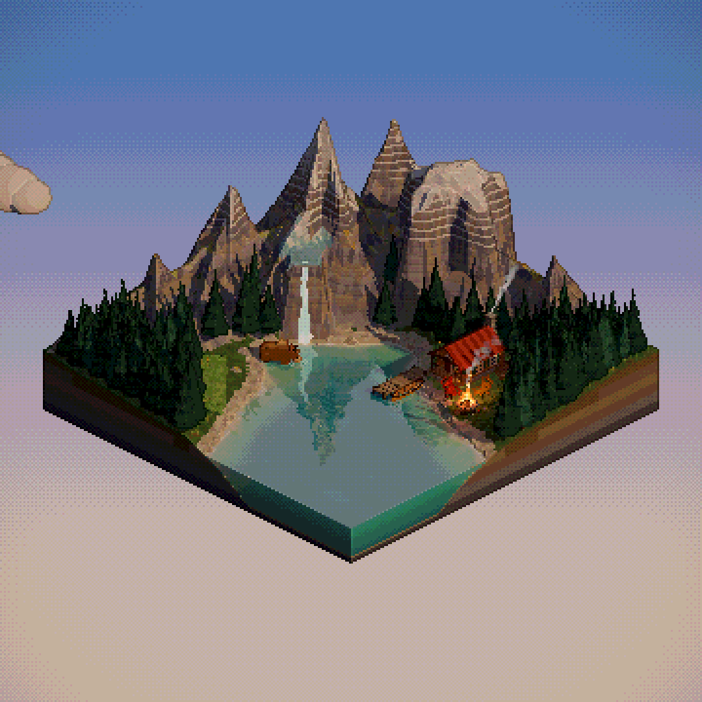
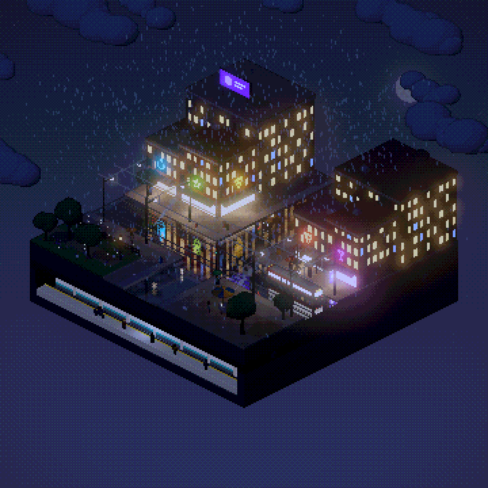
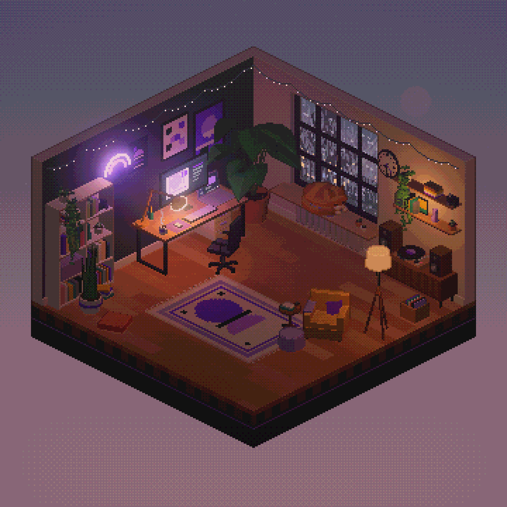
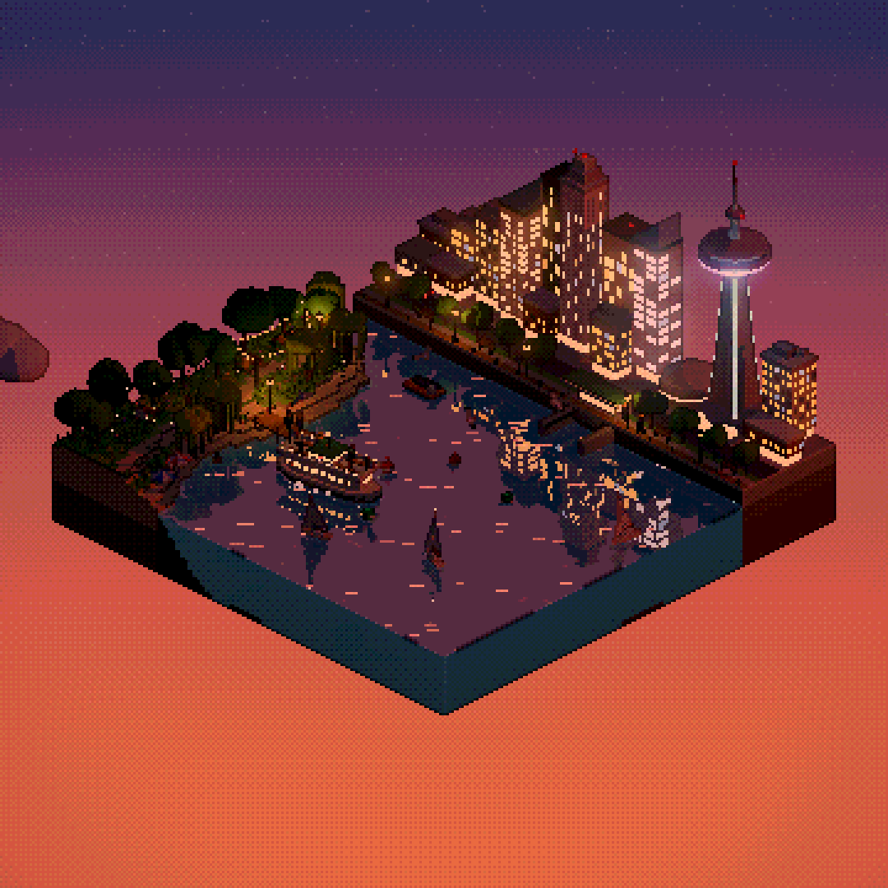
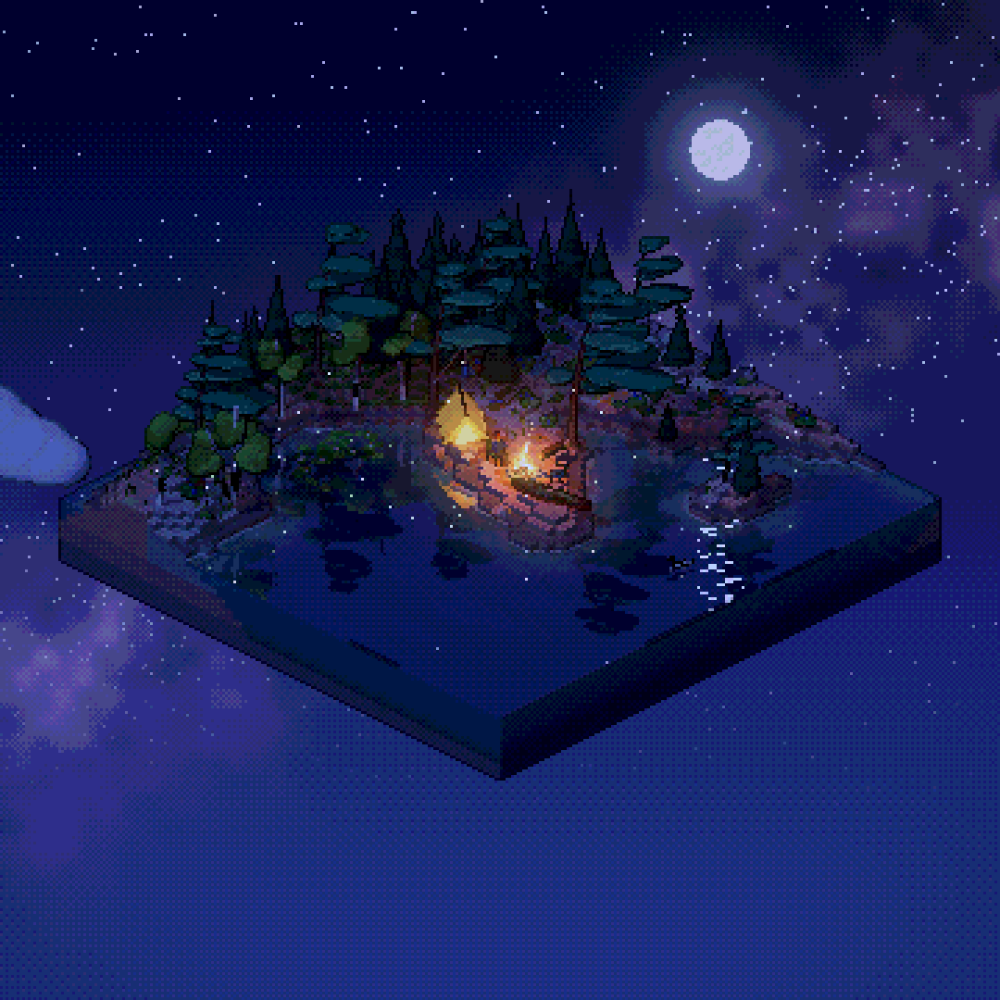
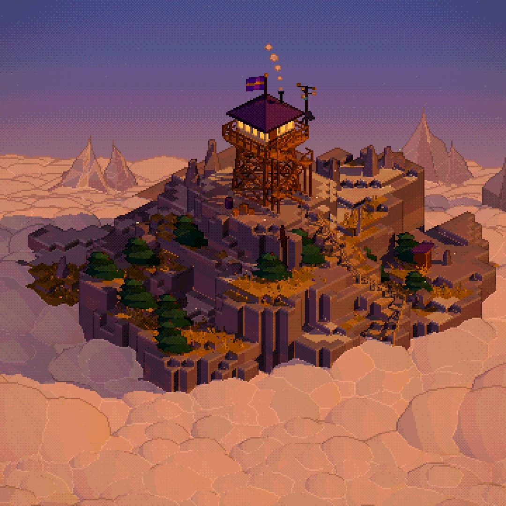
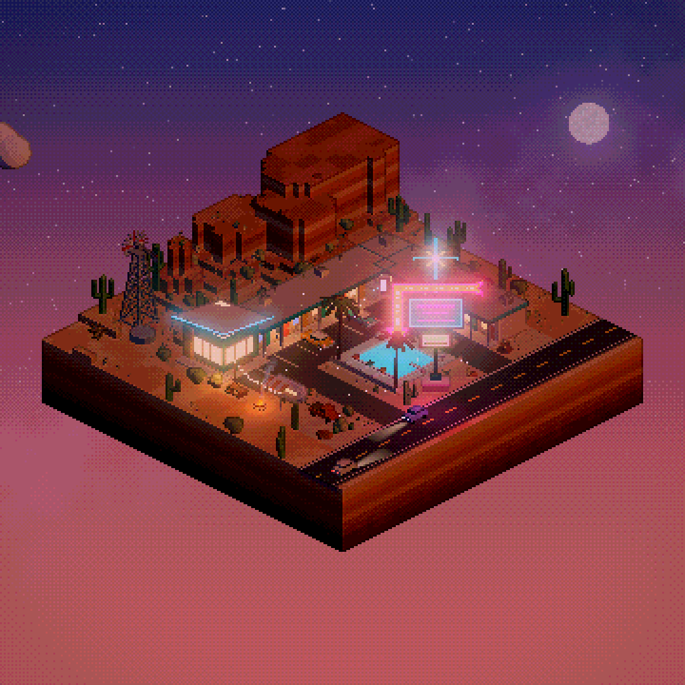
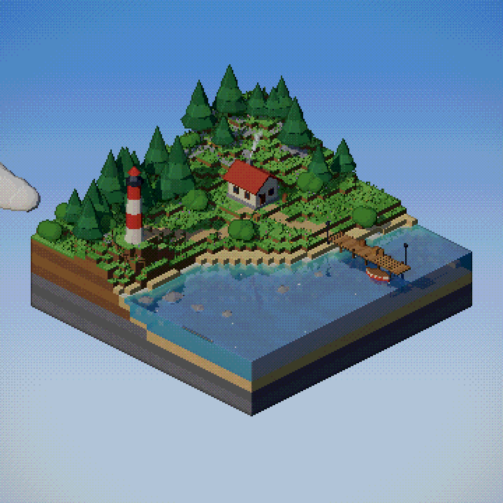

# Noxe Pixel Engine

Real-time 3D dioramas rendered as pixel art in the browser. Change the time of day and the weather, press a scene's own buttons, and export the result as a 60 fps MP4 with sound.

**[Try the live demo](https://pixel.noxestudio.com/)**. Best in Chrome or Edge on a computer. Link straight to a scene with `?scene=Name`, for example [Streetcar](https://pixel.noxestudio.com/?scene=Streetcar).



<table>
  <tr>
    <td></td>
    <td></td>
    <td></td>
    <td></td>
  </tr>
  <tr>
    <td></td>
    <td></td>
    <td></td>
    <td></td>
  </tr>
</table>

Everything is code. The scenes are modelled procedurally with three.js and every sound is synthesised in the browser, so there are no image, model or audio files to load, and no build step.

## Features

- **Pixel art renderer.** Each frame renders at low resolution with toon lighting and hard shadows, then gets depth outlines, edge highlights, glow, fog, colour grading and colour quantising with an ordered dither before a nearest-neighbour blow-up. The orthographic camera snaps to whole pixels, so still scenes never shimmer.
- **Time of day.** Dawn, day, dusk and night with a moving sun and moon, stars, the Milky Way and aurora. Lamps and windows switch on as it gets dark.
- **Weather.** Clear, cloudy, rain, storm with lightning, snow that settles on everything, and fog, all blending into each other over a few seconds.
- **Reflections.** Planar mirror reflections on lakes, harbours and wet streets.
- **Sound.** Wind, rain (outdoors, or on the roof for indoor scenes), water, birds, crickets and thunder, plus each scene's own sounds: a streetcar bell, a ferry horn, a loon, a bear's roar.
- **Clip export.** Renders offline at a locked 60 fps with the sound in sync and writes a standard MP4 (H.264 + AAC) that X and other platforms accept as is. 16:9, square and portrait, at twice the output size (4K for 16:9).

## Run it

You need Python 3 and a recent Chrome or Edge (the MP4 export uses WebCodecs).

```bash
git clone https://github.com/danieljan-design/noxe-pixel-engine.git
cd noxe-pixel-engine
python3 tools/serve.py
```

Then open http://localhost:5184. Any static file server works. `tools/serve.py` just turns off browser caching, so your edits always show up on reload.

## Controls

| Key | Action |
|---|---|
| 1 to 4 | Dawn, day, dusk, night |
| 5 to 0 | Clear, cloudy, rain, storm, snow, fog |
| Q W E | The scene's own buttons |
| [ and ] | Previous and next scene |
| C | Let the day run |
| Space | Pause |
| G | Render the scene's demo clip |
| T | Start or stop a take (your own sequence, re-rendered offline) |
| R | Live recording |
| P | Save a PNG |
| H / U | Hide the settings panel / the on-stage controls |

Drag to turn the camera, scroll to zoom. Open a scene directly with `?scene=Name`, and add `&clean=1` to ignore saved settings.

On a phone held upright the scene fills the screen. Tabs at the bottom switch between time, sky and the scene's own buttons, the round buttons play the day and turn on sound, and the button in the top corner opens the settings.

## Scenes

| Scene | Opens on | Buttons (Q W E) |
|---|---|---|
| Alpine | Rockies valley on a clear afternoon: banded peaks, glacier and waterfall, a turquoise lake that mirrors the peaks, log cabin, campfire, a grizzly that wanders and fishes | Bear (rears, roars, catches a fish), Fire, Alpenglow |
| Streetcar | Toronto intersection on a rainy night: streetcar on the wire, traffic lights, neon, wet reflections, cutaway subway station | Streetcar, Subway, Neon |
| Studio | Noxe Studio loft, evening rain: desk and monitor, cat on the sill, posters, turntable, clock that follows the hour | Vinyl (lofi + crackle), Lamp, Screen |
| Ferry | Toronto harbour at sunset: island ferry, skyline that lights up window by window, needle tower | Fireworks, Horn, Skyline |
| Campsite | Algonquin lake point at night: tent, campfire, canoe, white pines, loon, Milky Way | Stoke, Aurora, Loon |
| Lookout | Fire lookout above a sea of clouds at golden hour, far peaks, eagle | Clouds, Lantern |
| Motel | Desert motel at dusk with the sign off: highway, pool, buttes | Neon (sign ignites), Truck |
| Cove | The first test scene: lighthouse, cottage, pier | Lighthouse, Horn |

## Recording

All clips are standard MP4 files (H.264 + AAC, index first) and land in your Downloads folder.

- **Demo clip (G)** renders the scene's storyboard, its signature moment, offline at 60 fps with sound. No dropped frames, however slow the machine.
- **Take (T)**: press T, play the scene with the buttons and keys, press T again. The take is re-rendered exactly, offline.
- **Live record (R)** records the canvas in real time. **Record with panel** captures the stage with the on-stage controls and tab audio. Chrome asks which tab to share: pick this one.
- **Output size** is under Scene > output: 16:9 (1920×1080), 4:5 (1080×1350), 1:1 (1080×1080) and 9:16. Clips render at twice that size with twice the pixel size (16:9 comes out 3840×2160): the same art pixel for pixel, and X's 1080p copy of the file is an exact half, so every art pixel still lands on whole pixels there.
- **Social kit.** With the save endpoint running (`python3 tools/save-endpoint.py`), `await __pixel.kit()` in the browser console renders every scene's demo clip as 16:9 and 1:1 MP4 (3840×2160, 2160×2160) and a hero photo as 4:5 and 1:1 PNG (2160×2700, 2160×2160) into `exports/`. Square and portrait frames use pixel size 3 (6 in the 2× files) with the camera fitted to the diorama.
- `tools/fmp4-to-mp4.py` rewrites a fragmented MP4 (from Chrome's MediaRecorder or a screen recorder) as a standard one without re-encoding.

## How it works

1. The scene renders at low resolution (output size ÷ pixel size, e.g. 480×270) into an HDR colour buffer, view normals and depth.
2. Glow: anything brighter than "glow from" (lamps, fireflies, the lighthouse) is blurred at half and quarter resolution.
3. Composite at low resolution: sky gradient and stars, outlines where depth jumps, edge highlights on convex creases, glow, fog, tone and grade, then colour quantising (levels or a palette) with a 4×4 ordered dither.
4. Nearest-neighbour blow-up to the output size. The orthographic camera snaps to whole pixels so still scenes never shimmer. Camera elevation 30° gives clean 2:1 pixel lines.

Materials are three.js toon materials patched by the engine: stepped light ramps, surface texture noise, wind sway, snow that settles on upward faces, wet darkening in rain, drifting cloud shadows, lamps that switch on at dusk, and water with depth colour, foam, rain rings and glints.

The environment runs time-of-day keyframes (sun or moon key light, ambient, sky, grade) and weather presets (clear, cloudy, rain, storm, snow, fog) that blend over a few seconds: rain streaks and splashes, snow, clouds, fireflies, lightning with thunder.

## Making a scene

`scenes/<file>.js` default-exports a definition. Register it in `SCENES` in `app.js`, and add a storyboard to `CLIPS` for its demo clip. `scenes/placeholder.js` is a plain grass block to start from.

```js
export default {
  name: 'Ferry',                       // label on the control bar
  view: { target: [x, y, z], size, azimuth: 45, elevation: 30 },   // orthographic iso camera
  look: { pixelSize: 4, quantize: 'levels', levels: 14, saturation: 1.1, bloom: 1.0, ... },  // see defaultLook()
  env: { hour: 19.5, weather: 'clear' },   // starting state
  audio: { water: 0.6, birds: 1, crickets: 1, foghorn: 0 },   // ambience levels 0..1
  mirror: { y: 0 },                    // optional planar reflection plane (water, wet streets)
  sky: { moon: 1, milky: 0.6, aurora: 0, moonPos: [0.82, 0.8] },  // night sky extras
  wind: [0.85, 0.53],                  // optional wind direction (x, z)
  actionsLabel: 'Ferry',               // optional label for the scene button group
  create({ engine, env, audio }) {
    return {
      root,                             // THREE.Group with everything
      info: { size, top, bottom, surfaceAt(x, z), isLand(x, z), weather? },  // where weather lands
      update(t, dt, env) {},            // every frame, t = env.time
      actions: [{ id, label, icon: [9 strings of 9 chars, '#' = pixel], run(env, audio), active?() }],  // 1 to 3 on-stage buttons (keys Q W E)
      onClick(raycaster, env) {},       // optional
    };
  },
};
```

`info.weather = { cx, cz, w, d, top, bottom, snowScale, splash }` limits rain, splashes and snow to a box.
`audio.rain: 'roof'` plays rain as heard from inside (muffled bed, taps on the roof, gutter drip, ticks on the glass, quieter wind), and `audio.rainLevel` (default 1) scales all rain sound for the scene.
For square and portrait exports the camera is fitted to the scene's silhouette. If a backdrop runs off the 16:9 frame (like the Lookout's cloud sea), add a `FIT` override in `app.js`.

### Materials (`engine/materials.js`)
Build solid things with `toon(color, options)`: `vertexColors`, `ramp` ('soft', 'hard', 'foliage', 'flat'),
`noise`/`noiseScale` (surface texture), `snow`/`wet` (0..1 how much weather shows), `wind` (sway, scales with local height above y = 0),
`emissive` + `emissiveIntensity` (HDR above ~2.4 glows), `lamp: true` (emissive only at dusk, night and in storms), `glow` (multiplier, animate with `setGlow(mat, v)`),
`water: true` (+ shallow, deep, foam, deepAt; needs an `aDepth` attribute, use `kit.water()`),
`mirror: true` (+ reflect, reflectWet, puddles; needs the scene `mirror` plane; the surface must sit on that plane),
`windows: { size: [w, h], frac: [x, y], base, top, lit, warm, cool, glass, power }` (procedural lit window grid on vertical faces, windows switch on one by one as lamps come up).
`fxMaterial({ vertexShader, fragmentShader, uniforms, blending })` for particles and beams; they never get outlines.
Shared uniforms (`shared.uTime`, `uWind`, `uWindStrength`, `uLamps`, `uDaylight`...) can be passed to effect shaders.

### Kits
- `scenes/kit.js`: `rng`, `noise2`, `smoothstep`, `paint`, `merge`, `mergeGroup` (one mesh per material for a static group or a vehicle, big draw-call saver), `jitter`, `mesh`, `lampLight` + `updateLamps` (point lights that follow env.lamps), `terrain` (stepped diorama block, strata, `cutouts` for cutaway holes), `water`, `pineGeometry`, `bushGeometry`, `rockGeometry`, `grass`, `flowers`, `glass` (lamp glass), `cottage`, `lighthouse`, `pier`, `boat`, `lampPost`, `fence`, `crate`, `barrel`, `smoke`, `disposeTree`.
- `scenes/kit-people.js`: `person(rand, { coat, pants, skin, hair, umbrella, hat, scale, pose })`, `walker(obj, points, { speed, mode, heightAt, dwell })` (also moves vehicles and boats).
- `scenes/kit-city.js`: `building` (window grid, shopfront, awning), `car`, `neon` + `neonFlicker`, `trafficLight`, `hydrant`, `bench`, `bin`.
- The `*-parts.js` files next to each scene hold its builders (trees, boulders, fire, canoe, bear...), and other scenes can import them.

### Sound (`engine/audio.js`)
One-shots: `audio.play(name, opts)` with bell, horn, loon, boom, whoosh, typing, tick, eagle, coyote, gull, rumble, spark, owl, chord, thunder.
Loops: `audio.setLoop(name, level)` with traffic, hum, fire, vinyl, lofi, howl, cicadas, buzz. Everything is silent until Sound is on.

### Scale and readability
At 1920×1080 with pixel size 4 and frame size ~17, one world unit is about 15 pixels. Anything thinner than ~0.07 units disappears.
Keep silhouettes bold, and keep text and real logos out of scenes.

### Review tools (browser console)
`__pixel.advance(seconds)` steps the world and renders (background tabs barely animate on their own).
`await __pixel.sheet(name, [[hour, weather, seconds, fn?], ...])` renders a grid of states to `exports/<name>.png`, and
`await __pixel.still(name, hour, weather)` saves one full frame. Both need the save endpoint: `python3 tools/save-endpoint.py` (port 5185).
`__pixel.load(name)` switches scene, and `__pixel.def` is the current scene definition.

### Performance
Aim for under 16 ms a frame. Every mesh costs a draw call in up to three passes (shadow, reflection, main), so merge static
clusters and vehicles with `mergeGroup`, share materials, and use InstancedMesh for repeats. The engine already skips tiny,
non-glowing details in the reflection and shadow passes, and `userData.noMirror` keeps anything out of reflections.

## Project structure

- `index.html`, `app.js`: the page, scene switching, the on-stage controls, the settings panel and the export tools
- `engine/pixel-engine.js`: render pipeline and camera
- `engine/shaders.js`: post-process GLSL
- `engine/materials.js`: toon material patch, shared uniforms, effects material
- `engine/environment.js`: time of day, weather and effects
- `engine/audio.js`: procedural ambience and sound effects
- `engine/exporter.js`: offline 60 fps export (WebCodecs) and the MP4 writer
- `engine/recorder.js`: live recording and the fragmented-to-standard MP4 rewrite
- `engine/palettes.js`: palette generation for the palette colour mode
- `scenes/`: the scenes, their parts and the shared kits
- `tools/`: the no-cache dev server, the save endpoint for review images, the MP4 rewriter
- `exports/`: renders and review images (ignored by git)

## Credits

- [three.js](https://threejs.org) and [lil-gui](https://lil-gui.georgealways.com), both MIT licensed, loaded from the jsDelivr CDN.
- Nunito, Outfit and IBM Plex Mono from Google Fonts, under the SIL Open Font License.

## License

MIT, see [LICENSE](LICENSE). Made by Daniel Jankulovski at [Noxe Studio](https://noxestudio.com).
